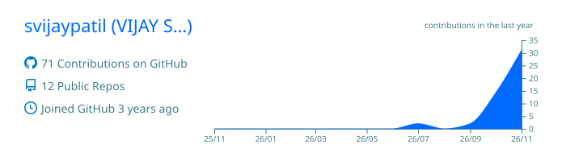
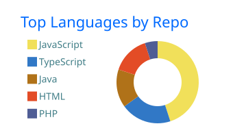
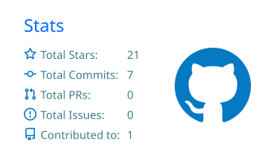

# Hi, I'm Vijay S Patil

**Software Engineer | Java · Spring Boot · AWS | Ex-Nokia**

MSc Software Engineering with Cloud Computing at City St George's, University of London  
London, United Kingdom

  <a href="https://vijayspatil.dev/"><strong>vijayspatil.dev</strong></a> &nbsp;·&nbsp;
  <a href="https://www.linkedin.com/in/svijaypatil"><strong>LinkedIn</strong></a> &nbsp;·&nbsp;
  <a href="https://github.com/svijaypatil"><strong>GitHub</strong></a> &nbsp;·&nbsp;
  <a href="mailto:vijayspatil.work@gmail.com"><strong>vijayspatil.work@gmail.com</strong></a>

---

### About Me

I'm a backend-focused Software Engineer with 10 months of production experience building and maintaining carrier-grade systems at **Nokia** (NFMT team, WaveSuite NOC). Most of my day-to-day work has centered on **Java, Spring Boot, React, PostgreSQL, and AWS**, working across enterprise Java backends, distributed systems, and cross-functional engineering teams.

Right now, I'm pursuing my **MSc in Software Engineering with Cloud Computing** at **City St George's, University of London**, and looking for **12-month Industrial Placement** or **Junior / Graduate Software Engineer** roles in the UK (eligible to work full-time without sponsorship during my placement year, with an 18-month Graduate Route after graduation).

---

### Experience

**Software Engineer Intern, Nokia** *(Aug 2025 to May 2026 | Bengaluru, India)*  
*WaveSuite Network Operations Center (WSNOC), NFMT Team*

- **OTDR Network Diagnostic Reporting:** Built an end-to-end diagnostic report across two production repositories by extending the Oracle DB schema with a new scan history table, adding a Hibernate ORM entity and HQL data service, and configuring a 19-column Excel/CSV/PDF export sheet with license gating.
- **Network Resiliency Provisioning:** Extended the connection provisioning stack across 10 Java classes, propagating parameters from REST endpoints through service coordination, path computation config, and CORBA IPC to a separate JVM, while updating capability configs for 38 hardware variants across two hardware families.
- **Concurrency & Thread-Pool Fix:** Tracked down and fixed a silent race condition causing thread pool exhaustion in a concurrent job scheduler with zero log trail by isolating a 50-line critical section with `ReentrantLock` and switching `BlockingQueue.take()` to timed `poll()`.
- **Legacy Dependency Removal:** Designed a six-phase, zero-downtime migration plan to remove a legacy intermediary across 22 production call sites, replacing it with a direct interface backed by 4 native DTOs and 14 REST endpoints.

---

### Featured Projects

| Project | What It Does & How It's Built | Stack |
| :--- | :--- | :--- |
| **[Resonate](https://github.com/svijaypatil/Resonate)** | Dual-backend AI voice diary platform. Spring Boot manages auth, CRUD, and webhooks while a Python FastAPI worker runs asynchronous transcription and LLM analysis, streaming live updates over WebSockets. Secured with AES-256 encryption at rest, Supabase RLS, and Redis rate limiting. | `Java` `Spring Boot` `FastAPI` `Next.js` `PostgreSQL` `WebSocket` `Redis` |
| **[ParallelMinds](https://github.com/svijaypatil/ParallelMinds)** | Real-time peer-matching platform running weighted clinical (PHQ-9/GAD-7) and spatial (`ST_DWithin`) queries directly in PostgreSQL/PostGIS, cutting matching latency from 400 ms to 15 ms. Includes AES-256-GCM encrypted Socket.io group chat and Redis TTL presence tracking. | `React` `Node.js` `PostgreSQL` `PostGIS` `Redis` `Socket.io` |

---

### Skills & Certifications

- **Languages:** Java, Python, TypeScript, JavaScript (ES6+), SQL, HQL
- **Backend & Distributed Systems:** Spring Boot, Spring MVC, Hibernate/JPA, FastAPI, Node.js, REST APIs, WebSockets, ActiveMQ, Quartz, CORBA, RPC
- **Databases & Caching:** PostgreSQL, PostGIS, Oracle DB, Redis, MySQL
- **Frontend:** React, Next.js, Tailwind CSS
- **Cloud, DevOps & Testing:** AWS, Docker, Linux, Git, JIRA, JUnit, Mockito
- **Certifications:** AWS Certified Cloud Practitioner, GitHub Foundations, Introduction to Cybersecurity Tools & Cyber Attacks, Full Stack Web Development Bootcamp

---

### Education

- **City St George's, University of London**, MSc Software Engineering with Cloud Computing *(Sept 2026 to Present)*
- **Vellore Institute of Technology (VIT)**, Master of Computer Applications (MCA) *(2024 to 2026)*
- **Christ Academy Institute for Advanced Studies**, BSc Computer Science *(2020 to 2023)*

---

### GitHub Activity

  
  
  

